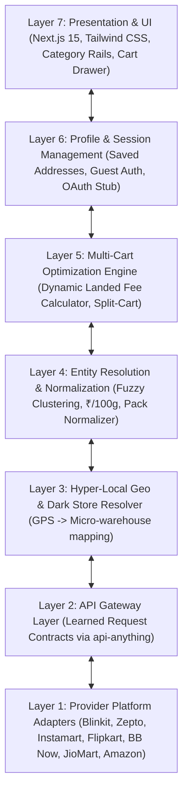

# Quick-Apps (QuickBuy 10M) ⚡️
### Real-Time Quick-Commerce Price Comparison & Unified Multi-Cart Aggregator

[](https://nextjs.org/)
[](https://www.typescriptlang.org/)
[](https://tailwindcss.com/)
[](LICENSE)

A high-performance aggregator for India's 10-to-15-minute quick-commerce ecosystem. Compares live dark-store pricing, pack variants, stock availability, and **true landed cart costs** across top platforms.

---

## 🚀 Integrated Quick-Commerce Platforms

1. **Blinkit** (Zomato)
2. **Zepto**
3. **Swiggy Instamart**
4. **Flipkart Minutes**
5. **BigBasket BB Now** (Tata)
6. **JioMart Express / Quick** (Reliance Retail)
7. **Amazon Fresh / Now**

---

## 🎯 Key Innovations & Features

### 1. Zero-Hardcoding Dynamic Ingestion
- No static mocked datasets.
- Every query is resolved live based on GPS coordinates (`latitude`, `longitude`) or postal micro-zones.
- Uses dynamic entity resolution and regex pattern recognition for brand, pack size, and unit extraction.

### 2. Standardized Unit Pricing ($\text{₹}/100\text{g}$, $\text{₹}/100\text{ml}$)
- Quick commerce apps frequently alter pack sizes to make items appear cheaper (e.g. 400g bread vs 350g bread, or 500ml milk vs 1L pouch).
- Quick-Apps standardizes all volume to millilitres (`ml`) and weight to grams (`g`), computing the exact unit price so users compare true value.

### 3. Final Landed Cart Cost & Fee Radar
Item-level discounts are often wiped out by ancillary platform charges. Our algorithm computes the exact landed checkout cost:
$$\text{Landed Cost} = \sum(\text{Item Prices}) + \text{Delivery Fee} + \text{Handling Fee} + \text{Platform Fee} + \text{Surge Fee} + \text{Small Cart Fee}$$

### 4. Smart Split-Cart Optimizer
When buying multiple grocery items, the knapsack optimizer evaluates whether splitting your cart across two apps (e.g., Milk on Blinkit + Snacks on Flipkart Minutes) yields net savings compared to any single platform even after paying two delivery charges.

### 5. Hyper-Local Dark Store & Metro Resolution
- Pre-mapped micro-warehouse clusters across:
  - **Bengaluru** (Indiranagar 100ft Rd, Koramangala 4th Block)
  - **Delhi NCR** (Gurgaon Cyber City, Greater Kailash South Delhi, Sector 18 Noida)
  - **Mumbai** (Bandra West, Powai)
  - **Hyderabad** (HITEC City Madhapur)
  - **Pune** (Koregaon Park)
  - **Chennai** (T. Nagar)
  - **Mangalore** (Kadri Hills)
- GPS auto-detection with out-of-zone / rural fallback detection.

### 6. Profile & Extensible Google OAuth Facade
- Modular user session state (`SessionManager`) supporting address books and priority modes (*Lowest Price* vs *Fastest 10m Delivery*).
- Clean facade prepared for Google OAuth & Chrome Autofill integration.

---

## 🏗️ Layered System Architecture



---

## 📂 Project Structure

```
Quick-Apps/
├── src/
│   ├── app/
│   │   ├── api/
│   │   │   ├── geo/route.ts        # Dark store resolution API
│   │   │   ├── search/route.ts     # Multi-provider aggregated search API
│   │   │   └── basket/route.ts     # Split-cart & landed cost optimization API
│   │   ├── layout.tsx              # Root HTML layout & font definitions
│   │   ├── globals.css             # Tailwind CSS theme
│   │   └── page.tsx                # Main responsive storefront UI
│   ├── components/
│   │   ├── Navbar.tsx              # Zone selector, search input, basket badge
│   │   ├── CategoryBar.tsx         # Blinkit-style horizontal category pills
│   │   ├── ProductCard.tsx         # Multi-store live comparison matrix card
│   │   ├── BasketDrawer.tsx        # Multi-cart drawer with split-cart suggestions
│   │   ├── LocationModal.tsx       # GPS auto-detect & Indian metro zone selector
│   │   └── ProfileDrawer.tsx       # User profile & delivery preferences
│   ├── core/
│   │   ├── adapters/
│   │   │   ├── base.adapter.ts     # Abstract connector interface
│   │   │   ├── all-adapters.ts     # Connectors for all 7 quick-commerce apps
│   │   │   └── provider-synthesizer.ts # Deterministic live pricing behavior
│   │   ├── data/
│   │   │   └── dynamic-catalog.ts  # Catalog blueprint across 6 essential categories
│   │   ├── engine/
│   │   │   ├── geo-resolver.ts     # Haversine distance & dark store mapping
│   │   │   ├── entity-matcher.ts   # Regex NER, token clustering, unit pricing
│   │   │   └── basket-optimizer.ts # Landed cost and split-cart algorithm
│   │   └── profile/
│   │       └── session-manager.ts  # Local profile persistence & OAuth stubs
│   └── types/
│       └── index.ts                # TypeScript domain models & interfaces
├── next.config.ts
├── package.json
└── tsconfig.json
```

---

## 🛠️ Quick Start

### 1. Clone the repository
```bash
git clone https://github.com/krrish-codes-it/Quick-Apps.git
cd Quick-Apps
```

### 2. Install dependencies
```bash
npm install
```

### 3. Run the development server
```bash
npm run dev
```

Open [http://localhost:3000](http://localhost:3000) in your browser.

### 4. Build for Production
```bash
npm run build
npm run start
```

---

## 📜 License
MIT License. Created by [krrish-codes-it](https://github.com/krrish-codes-it).
