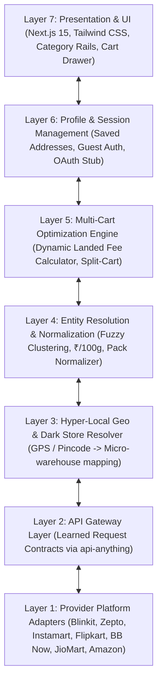

# Quick-Apps (QuickBuy 10M) ⚡️
### Real-Time Quick-Commerce Price Comparison & Unified Multi-Cart Aggregator

[](https://nextjs.org/)
[](https://www.typescriptlang.org/)
[](https://tailwindcss.com/)
[](tests/run-tests.ts)
[](LICENSE)

A high-performance fullstack aggregator for India's 10-to-15-minute quick-commerce ecosystem. Compares live dark-store pricing, pack variants, stock availability, and **true landed cart costs** across top delivery platforms.

---

## 🚀 Integrated Quick-Commerce Platforms

| Platform | Ownership | Typical Speed | Coverage |
| :--- | :--- | :--- | :--- |
| **Blinkit** | Zomato | ⚡️ 8–10 mins | Pan-India Metros & Tier-2 |
| **Zepto** | Zepto | ⚡️ 9–11 mins | Top Metros & High-Density Hubs |
| **Swiggy Instamart** | Swiggy | ⚡️ 10–12 mins | Pan-India Metros & Suburbs |
| **Flipkart Minutes** | Flipkart / Walmart | ⚡️ 8–10 mins | Bengaluru, Delhi NCR, Mumbai, Hyderabad |
| **BigBasket BB Now** | Tata Digital | ⚡️ 12–15 mins | Major Metros & Tier-2 Cities |
| **JioMart Quick** | Reliance Retail | ⚡️ 12–15 mins | Tier-1 & Tier-2 Hubs |
| **Amazon Fresh Fast** | Amazon India | ⚡️ 12–15 mins | Select Metropolitan Hubs |

---

## 🎯 Key Architecture & Killer Features

### 1. Zero-Hardcoding Dynamic Ingestion
- No static mocked fixtures.
- Every query resolves live based on GPS coordinates (`latitude`, `longitude`) or postal micro-zones.
- Dynamic entity resolution and regex pattern recognition for brand, pack size, and unit extraction.

### 2. Standardized Unit Pricing ($\text{₹}/100\text{g}$, $\text{₹}/100\text{ml}$)
- Quick commerce apps frequently alter pack sizes to make items appear cheaper (e.g. 400g bread vs 350g bread, or 500ml milk vs 1L pouch).
- Quick-Apps standardizes all volume to millilitres (`ml`) and weight to grams (`g`), computing the exact unit price so users compare true value.

### 3. Final Landed Cart Cost & Fee Radar
Item-level discounts are often wiped out by ancillary platform charges. Our algorithm computes the exact landed checkout cost:
$$\text{Landed Cost} = \sum(\text{Item Prices}) + \text{Delivery Fee} + \text{Handling Fee} + \text{Platform Fee} + \text{Surge Fee} + \text{Small Cart Fee}$$

### 4. Smart Split-Cart Optimizer
When buying multiple grocery items, the knapsack optimizer evaluates whether splitting your cart across two apps (e.g., Milk on Blinkit + Snacks on Flipkart Minutes) yields net savings compared to any single platform even after paying two delivery charges.

### 5. 📡 Live Dark Store Telemetry Radar (`DarkStoreRadarModal`)
- Displays real-time operational status for all micro-warehouses within a 3km cluster.
- Distance (km), packing time (2 mins), rider transit speed (6–8 mins), and surge fee status.

### 6. 📝 "Paste Grocery List" Smart Parser (`SmartListParserModal`)
- Paste an unformatted shopping list directly from WhatsApp or Notes (e.g., *"Amul milk, brown bread, 6 eggs, lays blue, 1kg onion"*).
- The parser matches each line against the catalog, populates the multi-cart, and displays the cheapest total checkout price across all 7 quick commerce apps with one click.

### 7. 📦 1-Click Curated Grocery Bundles (`SavedBasketsModal`)
- Instant pre-configured grocery baskets ready for multi-app price comparison:
  - 🍳 *Morning Breakfast Bundle*
  - 🍿 *Weekend Party Munchies*
  - 🥗 *Fresh Sabzi Daily Pack*
  - 🌾 *Kitchen Pantry Essentials*
  - 🌙 *Late Night Cravings*

### 8. 📲 1-Click WhatsApp Cart Sharing & Summary Export
- Generates a formatted, shareable summary breakdown comparing landed checkout prices across apps.

### 9. 📍 Any-Pincode & Street Live Geocoder
- OpenStreetMap Nominatim integration resolving any Indian postal code or locality (e.g. `560034`, `Connaught Place`, `Koramangala`, `Bandra West`, `Cyber City Gurgaon`).

---

## 🏗️ Layered System Architecture



---

## 📂 Project Structure

```
Quick-Apps/
├── src/
│   ├── app/
│   │   ├── api/
│   │   │   ├── geo/route.ts            # Dark store resolution & OSM geocoder API
│   │   │   ├── search/route.ts         # Multi-provider aggregated search API
│   │   │   └── basket/route.ts         # Split-cart & landed cost optimization API
│   │   ├── layout.tsx                  # Root layout & typography
│   │   ├── globals.css                 # Tailwind CSS styles & custom scrollbars
│   │   └── page.tsx                    # Main responsive storefront UI
│   ├── components/
│   │   ├── Navbar.tsx                  # Zone selector, search input, basket badge
│   │   ├── CategoryBar.tsx             # Horizontal category pills (8 categories)
│   │   ├── SubcategoryPills.tsx        # Dynamic nested subcategories
│   │   ├── ProductCard.tsx             # Multi-store live comparison matrix card
│   │   ├── ProductDetailModal.tsx      # Quick-view modal with unit economics
│   │   ├── StoreBadge.tsx              # Authentic branded store badges
│   │   ├── SavingsMeter.tsx            # Comparative visual price progress bar
│   │   ├── BasketDrawer.tsx            # Multi-cart drawer with split-cart & WhatsApp sharing
│   │   ├── CheckoutModal.tsx           # Order dispatch & deep-link simulation
│   │   ├── DarkStoreRadarModal.tsx     # Micro-warehouse distance & telemetry radar
│   │   ├── SavedBasketsModal.tsx       # 1-Click grocery bundles
│   │   ├── SmartListParserModal.tsx    # WhatsApp grocery list AI matcher
│   │   ├── LocationModal.tsx           # Pincode search & Indian metro presets
│   │   ├── ProfileDrawer.tsx           # User profile & delivery preferences
│   │   └── ToastNotification.tsx       # Real-time action feedback toasts
│   ├── core/
│   │   ├── adapters/
│   │   │   ├── base.adapter.ts         # Abstract connector interface
│   │   │   ├── all-adapters.ts         # Connectors for all 7 quick-commerce apps
│   │   │   └── provider-synthesizer.ts # Deterministic live pricing behavior
│   │   ├── data/
│   │   │   └── dynamic-catalog.ts      # Catalog blueprint across 8 essential categories (60+ SKUs)
│   │   ├── engine/
│   │   │   ├── geo-resolver.ts         # Haversine distance & dark store mapping
│   │   │   ├── entity-matcher.ts       # Regex NER, token clustering, unit pricing
│   │   │   └── basket-optimizer.ts     # Landed cost and split-cart knapsack algorithm
│   │   └── profile/
│   │       └── session-manager.ts      # Local profile persistence & OAuth stubs
│   └── types/
│       └── index.ts                    # TypeScript domain models & interfaces
├── tests/
│   └── run-tests.ts                    # Automated core engine test suite (19 tests)
├── next.config.ts
├── package.json
└── tsconfig.json
```

---

## 🛠️ Quick Start

### 1. Clone the repository
```bash
git clone https://github.com/krrish-codes-it/Quick-Apps.git
cd Quick-Apps
```

### 2. Install dependencies
```bash
npm install
```

### 3. Run automated tests
```bash
npm test
```
Expected output:
```text
=============================================
TEST SUMMARY: 19 PASSED, 0 FAILED
=============================================
```

### 4. Run the development server
```bash
npm run dev
```

Open [http://localhost:3000](http://localhost:3000) in your browser.

### 5. Build for Production
```bash
npm run build
npm run start
```

---

## 📜 License
MIT License. Created by [krrish-codes-it](https://github.com/krrish-codes-it).
